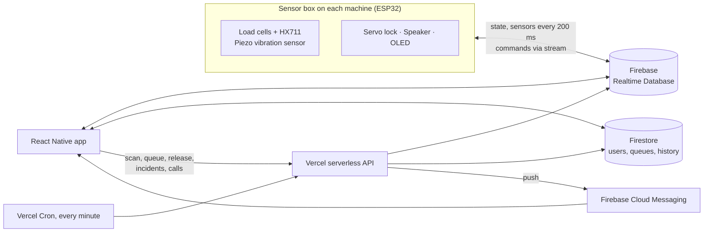
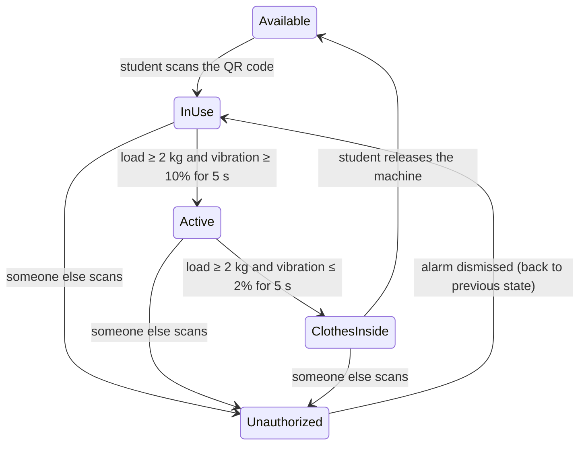

# Laundrix – Smart Laundry IoT System

Laundrix tells students which campus washing machines are free, lets them queue from their phone, and locks each machine so only the person whose turn it is can use it. A sensor box on every machine detects whether it is idle, washing or finished. A React Native app shows the live status, handles the queue, and alerts the owner and the hostel admin if someone uses the machine out of turn.

Built by a team of four for the CT125 Digital Technology course (Semester II 2025/2026), for a campus where students waited about 35 minutes for a machine at peak times.

**Backend API:** [Laundrix-Backend](https://github.com/ngweibin050-dev/Laundrix-Backend)

## Results from testing

| What was tested | Before the fix | After |
| --- | --- | --- |
| Device ↔ app sync latency (5 users sending commands mid-write) | mean 1,341 ms, max 1,502 ms | **mean 456 ms, max 531 ms** |
| Vibration reading on a running machine | jumped between 1–23% (missed the *Active* state) | **steady 22–25%** |
| Reboot with 7.5 kg of laundry inside (simulated power cut) | scale reset to 0 kg, state lost | **read 7.54 kg, state restored** |

All 8 test cases (unit, system, integration and acceptance) passed after these fixes. The tests were run manually on the physical device.

## How it works



### Machine states

The firmware moves between five states using sensor readings that must hold for 5 seconds:



### A laundry session

1. **Queue.** The student joins a machine's queue in the app. The backend uses an idempotency key and a Firestore transaction, so double taps can't add them twice.
2. **Your turn.** When the machine is free and they are first in line, they get a push notification and a 5-minute grace period to scan the machine's QR code. A server cron removes them if they don't.
3. **Wash.** Scanning claims the machine and locks the door. The sensor box detects the wash starting and finishing, and the app shows live weight, vibration and an estimated finish time.
4. **Collect.** When the wash ends, the student is reminded to collect their clothes and release the machine. The next person in line is then notified.
5. **Out-of-turn use.** If someone else scans the machine, an incident starts:
   - The owner gets 60 seconds to answer "That's me" or "Not me".
   - "Not me" alerts the admin and sounds the alarm on the machine.
   - No answer logs it as unauthorized use and notifies the admins.

## Features

- Live dashboard of every machine, with state, load and vibration
- Virtual queue with live position and leave-queue
- QR check-in and remote lock/unlock from the app
- Grace periods with countdown alarms (turn to claim, clothes to collect)
- Separate incident screens for the owner, the intruder and the admin
- Push notifications (FCM) for 10+ event types, with in-app notification history
- In-app chat per machine, plus voice and video calls between users (LiveKit)
- AI help assistant powered by Google Gemini through a Cloudflare Worker
- Admin export of usage history to Excel
- English, Malay and Chinese; Google sign-in

## Hardware

| Component | Role |
| --- | --- |
| ESP32-WROOM (38-pin) + expansion board | Controller |
| 4 × 50 kg load cells + HX711 24-bit ADC | Weight of laundry |
| PES1-Q46F3A piezo contact sensor | Vibration of the drum |
| MG946R servo motor | Door lock latch |
| DFPlayer Mini + 4 Ω 3 W speaker | Voice prompts and alarm |
| SSD1306 0.96" OLED | Machine state on the device |
| LM2596 buck converter, 12 V 2 A adapter | Power |

### Firmware highlights

- **Vibration signal processing:** takes 200 samples at 2 kHz, removes the DC offset, computes RMS, then applies an asymmetric moving average. It rises fast (α = 0.6) and decays slowly (α = 0.15), so short knocks don't trigger state changes.
- **Power-cut recovery:**
  - Scale calibration is stored in EEPROM, and the scale only tares on the very first boot.
  - After a reboot the machine state is restored from Firebase, and stale commands are cleared.
- **Race-free sync:**
  - The device reads state every 200 ms, but writes state only on sensor-confirmed transitions.
  - App commands arrive through a Firebase stream listener.
  - A 500 ms cooldown stops the device overwriting its own writes.
- **Resilient Wi-Fi:** retries for up to 5 minutes, resetting the Wi-Fi stack every 60 seconds, then reboots.
- **Local web dashboard:** each device serves a page on port 80 showing state, sensor readings, a log buffer and maintenance buttons.

## Tech stack

| Layer | Technology |
| --- | --- |
| Mobile app | React Native 0.81, Expo SDK 54, Expo Router, TypeScript, Zustand, React Native Paper |
| Data | Firebase Auth, Firestore, Realtime Database, Cloud Messaging; Notifee |
| Backend | Vercel serverless functions (TypeScript), Firebase Admin SDK, Vercel Cron |
| Calls and AI | LiveKit (voice/video), Google Gemini via a Cloudflare Worker |
| Firmware | Arduino C++ on ESP32: HX711, ESP32Servo, DFRobotDFPlayerMini, Adafruit SSD1306, Firebase ESP32 Client |

## Repository layout

```
app/              screens (Expo Router): auth, tabs (dashboard, queue, history, chat…), iot, admin, calls
components/       incident and grace-period modals, dashboard and queue components
services/         machine, queue, notification, call and API services
repositories/     Firebase data sources used by the view models
viewmodels/       screen logic (MVVM)
```

## Run it locally

**App**

```bash
npm install
npx expo run:android          # needs a development build (native Firebase modules)
```

Create a `.env` file (git-ignored) with:

```
EXPO_PUBLIC_FIREBASE_API_KEY=
EXPO_PUBLIC_FIREBASE_AUTH_DOMAIN=
EXPO_PUBLIC_FIREBASE_PROJECT_ID=
EXPO_PUBLIC_FIREBASE_STORAGE_BUCKET=
EXPO_PUBLIC_FIREBASE_MESSAGING_SENDER_ID=
EXPO_PUBLIC_FIREBASE_APP_ID=
EXPO_PUBLIC_FIREBASE_DATABASE_URL=
EXPO_PUBLIC_BACKEND_URL=
EXPO_PUBLIC_LIVEKIT_URL=
```

Download `google-services.json` (Android) and `GoogleService-Info.plist` (iOS) from your Firebase project into the repo root. They are git-ignored. For EAS cloud builds, upload them as [EAS file environment variables](https://docs.expo.dev/eas/environment-variables/).

**Firmware**

Flash the ESP32 sketch with the Arduino IDE (ESP32 board package), after setting your Wi-Fi details, Firebase project and `MACHINE_ID`.

## Known limitations

- **The backend does not yet verify Firebase ID tokens.** Endpoints trust the `userId` in the request body, so the next step is to require a token and check it matches the user. See [Laundrix-Backend](https://github.com/ngweibin050-dev/Laundrix-Backend#security).
- Needs continuous Wi-Fi; there is no offline mode.
- The load cell drifts about 50 g per day, and vibration from neighbouring machines can add 3–4%.
- One sensor box per machine; the Firebase schema was tested with a single machine.

## Team

Built by a team of four for CT125 Digital Technology.
Ng Wei Bin
Tey Hao Rui
Aisyah
Nabila
